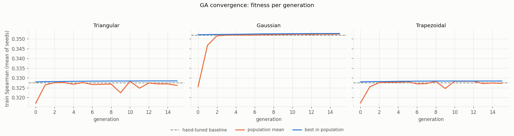

# Fuzzy-GA Hybrid Movie Recommender

A movie and series recommender that combines **fuzzy logic** with a **genetic algorithm (GA)**.

- A Mamdani fuzzy system scores every title from three features: **rating**, **popularity** and **recency**.
- A GA (built with DEAP) **evolves the weights of the 10 fuzzy rules** to improve recommendations over a hand-tuned baseline.
- Recommendations are evaluated against real user ratings from **MovieLens** on a time-ordered train/test split, using **Precision@10**.

Built as the course project for *INT3141 Soft Computing Techniques* (B.Tech IT, Manipal University Jaipur).



---

## How it works

```
IMDb title.basics + title.ratings ──► features per title ──► fuzzy system ──► score in [0, 1]
                                       (rating, popularity,      ▲
MovieLens ratings ──► per-user         recency)                  │ 10 rule weights
  train / test split ──────────────────────────────► GA fitness ─┘ (evolved by the GA)
```

### 1. Features (`build_features.py`)
Features come from the IMDb non-commercial datasets, so no MovieLens rating leaks into the score. MovieLens movies are linked to IMDb through `imdbId`.

| Feature | Definition |
|---|---|
| `rating` | Bayesian-weighted IMDb rating (pulls low-vote titles toward the mean, m = 1000) |
| `popularity` | log10 of the IMDb vote count (votes span ~100 to ~3,000,000) |
| `recency` | age in years (2026 − start year), capped at 60 |

Titles with fewer than 100 votes, adult titles, and titles with no year are dropped. Movies, TV series and mini-series are kept.

### 2. Fuzzy system (`fuzzy_system.py`)
- Three fuzzy sets per input (Low / Medium / High, or New / Mid / Old for recency).
- Three membership-function families built from the same parameters for a fair comparison: **Triangular**, **Gaussian** and **Trapezoidal**.
- 10 rules, e.g. *IF rating is High AND popularity is High THEN score is High*, or *IF rating is High AND popularity is Low THEN score is Medium* ("hidden gem").
- Each rule's firing strength (AND = min) is multiplied by its **weight**; rules with the same output are combined with max, and the output is defuzzified with the **centroid** method.
- Rule evaluation is vectorised with NumPy, so the whole catalogue is scored in one call. The GA needs thousands of evaluations, so this is much faster than scoring titles one at a time.

### 3. Evaluation (`evaluation.py`)
- Each user's ratings are sorted by time. The **earliest 70% are train** (used by the GA) and the **latest 30% are test** (used only for the final report).
- **Precision@10:** for each user, rank the movies they rated by fuzzy score and measure how many of the top 10 they rated ≥ 4 stars. Averaged over users.
- **Spearman:** per-user rank correlation between fuzzy score and the user's actual ratings. Reported alongside P@10.

### 4. Genetic algorithm (`ga.py`)
| Component | Choice |
|---|---|
| Chromosome | 10 floats in [0, 1], one weight per rule |
| Fitness | mean per-user Precision@10 on the **train** split (`--metric spearman` also available) |
| Selection | tournament (size 3) |
| Crossover | blend crossover (α = 0.3), p = 0.7 |
| Mutation | Gaussian (σ = 0.15, per-gene p = 0.3), p = 0.4 |
| Elitism | best 2 individuals carried over each generation |
| Setup | population 30, 20 generations, 5 random seeds per membership family |

The weight-independent part of the fuzzy computation (rule firing strengths) is cached, so each fitness evaluation only redoes the weighted aggregation. An assertion checks that this fast path matches the reference implementation exactly.

---

## Results

Held-out **test** split (latest 30% of each user's ratings). The GA uses Precision@10 as its fitness; GA values are the mean of 5 seeds.

| Membership family | Baseline P@10 | GA P@10 | Baseline Spearman | GA Spearman |
|---|---|---|---|---|
| Triangular | 0.6584 | 0.6577 ± 0.0004 | 0.2889 | 0.2902 |
| Gaussian | 0.6616 | 0.6609 ± 0.0008 | 0.2987 | 0.2840 |
| Trapezoidal | 0.6584 | 0.6575 ± 0.0006 | 0.2889 | 0.2902 |

Reference rankers on the same test split:

| Ranker | Test P@10 | Test Spearman |
|---|---|---|
| Random (mean of 20) | 0.5430 | −0.0050 |
| Popularity only | 0.6270 | 0.1585 |
| IMDb rating alone | 0.6618 | 0.3020 |

### What the results show
- The fuzzy recommender is clearly better than random (+0.115 P@10) and than popularity alone.
- The GA improves **train** P@10 slightly (0.7203 → 0.7210 for Triangular), but the gain **does not carry over to the test split**. The hand-tuned baseline is already close to the best these features allow.
- The evolved weights vary a lot between seeds while fitness stays almost identical. Many weight vectors produce nearly the same ranking, which means the fitness landscape is very flat.
- **Why:** all three features describe the *title*, not the *user*, so every user gets the same ranking. Changing rule weights can only reshuffle a single global ordering, and that ordering is dominated by the rating feature.

---

## Limitations and next steps
- **No personalisation.** Adding a per-user feature (e.g. genre affinity from each user's training ratings) would give the GA a user-specific signal to optimise.
- **Evaluation ranks only movies each user has rated**, not the full catalogue, so P@10 measures ordering quality within each user's history.
- **Dataset:** MovieLens `ml-latest-small` (~100K ratings, 610 users). Results may differ on larger MovieLens releases.

---

## Project structure

```
download_data.py         downloads IMDb + MovieLens into data/
inspect_data.py          quick look at the raw data
build_features.py        builds the per-title feature table and the MovieLens ↔ IMDb link
plot_membership.py       plots the triangular membership functions against the data
membership_variants.py   compares triangular / Gaussian / trapezoidal families
fuzzy_system.py          rule base, fuzzification, weighted Mamdani inference
evaluation.py            train/test split, Precision@10 and Spearman, reference rankers
ga.py                    DEAP genetic algorithm, results report, convergence plot
data/processed/          saved GA results (JSON) and plots
```

---

## Running it (Windows PowerShell)

```powershell
# 1. Create and activate a virtual environment
python -m venv .venv
.\.venv\Scripts\Activate.ps1

# 2. Install dependencies
pip install -r requirements.txt

# 3. Download data (~250 MB for the IMDb files) and build features
python download_data.py
python build_features.py

# 4. Baseline evaluation and reference rankers
python evaluation.py

# 5. Run the GA for all three membership families (about 2.5 min per family)
python ga.py

# Options
python ga.py --family Gaussian      # one family only
python ga.py --metric spearman      # use Spearman as the GA fitness
python ga.py --report               # re-print results and redraw the plot from saved runs
```

Raw data is not committed to the repository; `download_data.py` and `build_features.py` recreate it.

## Data sources
- [MovieLens](https://grouplens.org/datasets/movielens/) `ml-latest-small`, GroupLens Research, University of Minnesota
- [IMDb non-commercial datasets](https://developer.imdb.com/non-commercial-datasets/) (`title.basics`, `title.ratings`), for personal and non-commercial use

## Tech stack
Python · pandas · NumPy · scikit-fuzzy · DEAP · Matplotlib
